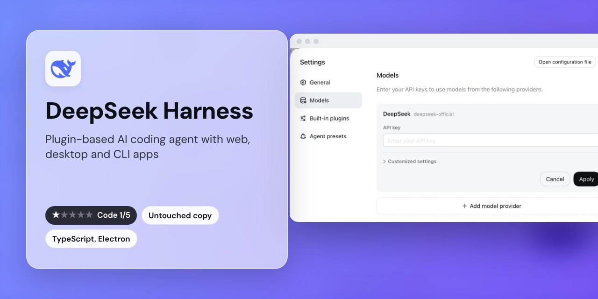
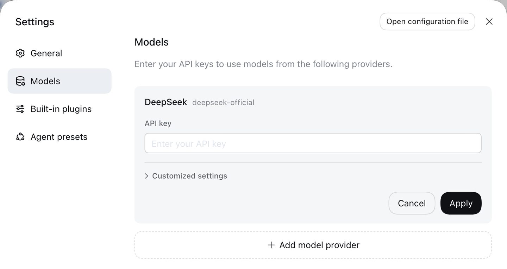

<!-- repo-card:start -->
<p align="center"></p>

<h2> DeepSeek Harness</h2>

**An unchanged copy of DeepSeek Harness, an open-source AI coding agent from DeepSeek AI. You give it a task and it reads files, runs commands and calls tools, from a command line, a web page or a desktop app.**

**Why it is here:** copied in October 2026 to try the harness and study how it is built (inferred: no own changes were made on top).

| | |
|---|---|
| **Status** | Untouched copy of [deepseek-ai/deepseek-harness](https://github.com/deepseek-ai/deepseek-harness), copied 4 Oct 2026 |
| **Code quality** | ★☆☆☆☆ 1/5 as own work: no own code on top. The upstream code itself is mature, with CI and thousands of tests |
| **Size** | No own code. Upstream is a very large TypeScript monorepo |
| **Stack** | pnpm TypeScript monorepo, Cordis plugin framework, React web UI, Electron desktop app |
| **What works** | Everything upstream ships: agent loop with sub-agents, MCP tools, saved sessions, context compaction, sandboxed shell, browser use, skills |
| **Worth reusing** | Better to install the upstream package (`npx @deepseek-ai/dsh web`) than to keep this copy |
| **Renamed** | Was `Harness` until 25 Nov 2026 |

<p align="center"></p>
<p align="center"><sub>Image from this repo: docs/user/guide/providers-models-page.png</sub></p>
<!-- repo-card:end -->

---

# DeepSeek Harness

English | [中文](README.zh.md)

DeepSeek Harness (`dsh`) is an open-source agent harness developed by [DeepSeek AI](https://deepseek.com).

It is built on an **everything-is-a-plugin** architecture and powered by [Cordis](https://github.com/cordiverse/cordis), whose design is described in [_A Programming Paradigm for Spatiotemporal Composability_](https://arxiv.org/abs/2608.25512).

Documentation: [https://deepseek-harness.github.io/deepseek-harness/](https://deepseek-harness.github.io/deepseek-harness/)

## Developer preview

DeepSeek Harness is in _developer preview_ and iterating rapidly. **THERE WILL BE COMPATIBILITY-BREAKING CHANGES.**

Review the [safety notice](SAFETY.md) before running the project.

## Run

### Run from `npm`

Install `Node.js`, then run:

```sh
npx @deepseek-ai/dsh web
```

The command starts the Web UI at `http://127.0.0.1:3080` by default and opens it in the default browser for a local launch. An SSH launch only prints the host URL because the SSH client or editor owns the local forwarded address. Pass `--no-open` to run the server without opening a browser. See [Web UI guide](docs/user/guide/index.md).

### Run from source

To run from a repository checkout:

```sh
git clone https://github.com/deepseek-ai/deepseek-harness.git
cd deepseek-harness
pnpm install
pnpm run build
pnpm dsh web
```

`pnpm run build` prepares the repository artifacts. `pnpm dsh web` uses those built artifacts without rebuilding.

## Community and support

- Submit feedback or bug reports through [GitHub Discussions](https://github.com/deepseek-ai/deepseek-harness/discussions).
- Add the [`dsh-plugin`](https://github.com/topics/dsh-plugin) topic to your plugin repository for discoverability.
- Join <a href="https://discord.gg/4MrtZUhpxg">DeepSeek Harness Discord community</a>.

## Contributing

See [CONTRIBUTING.md](CONTRIBUTING.md).

## Development

Start with the [development guide](docs/development.md) and [architecture documentation](docs/architecture.md).

`pnpm run dev:web` builds, serves, and rebuilds client bundles on source edits in one terminal, and `make help` lists the matching Make targets for Web and Desktop; the guide's application commands section owns the full table.

For agents, follow [AGENTS.md](AGENTS.md).

## Citation

```bibtex
@misc{deepseek-harness2026,
  title={DeepSeek Harness: Everything is a Plugin},
  author={DeepSeek-AI},
  year={2026},
  publisher={GitHub},
  howpublished={\url{https://github.com/deepseek-ai/deepseek-harness}},
}
```

## License

[MIT](LICENSE)

Third-party dependencies and their licenses are disclosed in [THIRD_PARTY_NOTICES.md](THIRD_PARTY_NOTICES.md).
